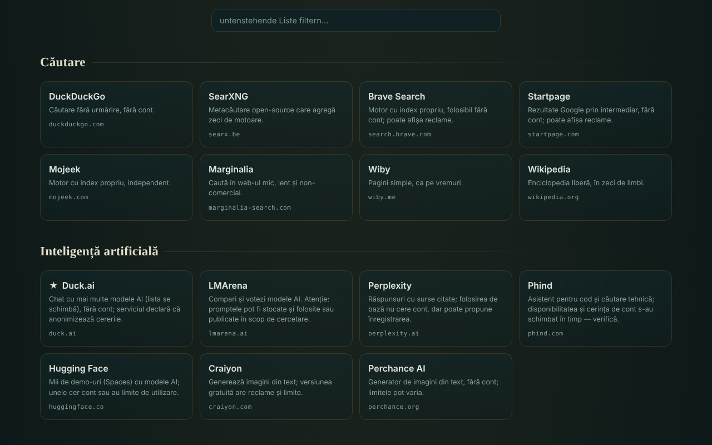

# OAZĂ — geschenkte Online-Dienste

[English](README.md) · [Română](README.ro.md) · [Français](README.fr.md) · [Italiano](README.it.md) · [Español](README.es.md) · [Português](README.pt.md) · **Deutsch** · [Magyar](README.hu.md)

**Version:** 1.2.5 · **Zuletzt aktualisiert:** 2026-10-22

Oberflächensprachen: **Română, English, Français, Italiano, Español, Português (PT), Deutsch, Magyar**

Katalog mit 340 kostenlosen Webdiensten in 54 Kategorien, ausgewählt, weil sie (in ihrer Grundform) ohne Konto nutzbar sind, in einer einzigen HTML-Datei.

**Online:** https://chiuta.github.io/OAZA/

## Was es ist

OAZĂ ist eine „Startseite“ im Geist der Trade-Free-Bewegung: eine Liste externer Werkzeuge und Dienste (Suche, KI, Karten, Code, Lesen, Musik, Wissenschaft, freie Software, rumänische Ressourcen u. a.), nach Kategorien gruppiert, mit einer Suchleiste, die die gewählte Suchmaschine öffnet. Der Autor hat die Liste am **16. Juni 2026** geprüft; sie **kann veraltet sein** (siehe „Grenzen und Warnhinweise“).

Die Datei ist ein bearbeitbarer „Quine“: Sie lässt sich in der Seite ändern, und die Schaltfläche „herunterladen“ erzeugt eine neue, ebenfalls eigenständige Datei mit deinen Änderungen.

## Funktionen

- 340 Dienste in 54 Kategorien; Karten mit Kurzbeschreibung, Domain und Etiketten (`TROM`, `local`, `instabil`, `temp`, ★ empfohlen); einige Kategorien haben einen Vorsichtshinweis.
- Sofortiges Filtern der Liste (ohne Beachtung von Diakritika: „cautare“ findet „Căutare“), mit einer Meldung, wenn es keine Ergebnisse gibt; die Taste `/` setzt den Cursor ins Filterfeld.
- Automatisches helles Design (`prefers-color-scheme: light`) und Druckstil (Karten in 3 Spalten, mit vollständiger Adresse; Leisten und Schaltflächen ausgeblendet).
- Suchleiste mit 7 Suchmaschinen (DuckDuckGo, SearXNG, Brave, Startpage, Mojeek, Marginalia, Wikipedia); die Suche öffnet sich in einem neuen Tab.
- Bearbeitungsmodus: Du fügst Dienste hinzu, änderst, verschiebst oder löschst sie; fügst Kategorien hinzu, benennst sie um oder löschst sie; bearbeitest Titel und Untertitel; siehst und bearbeitest die rohen JSON-Daten; importierst/exportierst JSON; setzt auf die Standardliste zurück.
- Teilen über einen Link mit `#d=`-Fragment (deine Liste ist in der Adresse kodiert); beim Öffnen erscheint ein Hinweis, dass die Liste nicht die des Autors ist, und die Adressen werden bereinigt (nur `http`/`https`).
- „Diese Datei herunterladen“ und „Quelle (Quine)“: Die Datei baut sich selbst wieder auf, einschließlich deiner Änderungen.
- Warnung beim Verlassen der Seite, wenn es ungespeicherte Änderungen gibt.
- Skript zur regelmäßigen Überprüfung der Dienste: `tools/verifica-servicii.mjs` (lokal auszuführen; auf dem Smartphone in Termux: `curl -sL https://raw.githubusercontent.com/chiuta/OAZA/main/tools/verifica-termux.sh | bash`; siehe `servicii-de-verificat.md`).

## Anleitung

1. Öffne die Seite und stöbere in den Kategorien oder tippe ins Feld „Liste filtern“, um die Karten einzugrenzen.
2. Für eine Websuche wähle links in der Leiste die Suchmaschine, tippe den Begriff und drücke „suchen“ oder Enter; die gewählte Suchmaschine öffnet sich in einem neuen Tab.
3. Klicke auf eine Karte, um den Dienst in einem neuen Tab zu öffnen. Lies vorher die Beschreibung und den Hinweis der Kategorie (Werbung, Grenzen, Lizenzen).
4. Um deine Liste anzupassen, drücke „✎ diese Seite bearbeiten“; nutze dann die Schaltflächen auf den Karten und die obere Leiste.
5. Um die Änderungen zu behalten, drücke „↧ diese Datei herunterladen“ und speichere die Datei; um sie jemand anderem zu schicken, drücke „⇗ Link“ (sehr große Listen erzeugen sehr lange Links).
6. „↺ zurücksetzen“ kehrt zur Standardliste zurück; „zum ursprünglichen Katalog zurückkehren“ (im Hinweis oben) entfernt eine aus einem Link geladene Liste.

## Datenschutz und Netzwerk

- Lokaler Speicher: Es werden weder `localStorage`, `sessionStorage`, IndexedDB noch Cookies verwendet; Änderungen existieren nur in der geöffneten Seite, bis du sie herunterlädst.
- Netzwerk: Die Seite lädt keine Skripte, Schriften, Bilder oder sonstigen externen Ressourcen. Der einzige Netzwerkaufruf der Seite ist eine Anfrage an die eigene Datei (gleicher Origin), die beim Laden nur erfolgt, wenn die Seite über `http(s)` ausgeliefert wird, für die Anzeige „Quine verifiziert“ am Abzeichen im Kopf; sie hat ein Timeout von 6 Sekunden. Eine `Content-Security-Policy` in der Seite beschränkt Verbindungen auf denselben Origin.
- Externe Hosts: die der 340 aufgelisteten Dienste (318 verschiedene Domains) und der 7 Suchmaschinen. Sie werden **nur kontaktiert, wenn du** auf eine Karte oder „suchen“ **klickst**; die Seite sendet keinen Referrer (`no-referrer`). Der Suchbegriff gelangt zur gewählten Suchmaschine, und was du auf den aufgelisteten Diensten tust, regeln diese, nicht OAZĂ.
- Browser-Berechtigungen: Sie verlangt keine Berechtigung (Standort, Kamera, Mikrofon).
- Die Aussage „ohne Telemetrie“ bezieht sich auf die OAZĂ-Datei, nicht auf die externen Dienste.

## Grenzen und Warnhinweise

- **Dienste Dritter.** Die aufgelisteten Dienste gehören nicht dem Autor und stehen in keiner Verbindung zu ihm (außer den mit TROM gekennzeichneten). Die Auflistung ist keine Empfehlung. Sie können ein Konto verlangen, Werbung anzeigen, kostenpflichtige Tarife hinzufügen, ihre Bedingungen ändern oder jederzeit verschwinden.
- **Nicht automatisch überprüfte Aussagen.** Etiketten wie „ohne Konto“, „kostenlos“, „Open Source“, „ohne Tracking“ geben das Wissen des Autors oder die Angaben der Dienste zum Prüfdatum (16. Juni 2026) wieder; sie sind keine Garantien. `servicii-de-verificat.md` enthält die Liste der Dienste, die manuell neu zu prüfen sind, und ein regelmäßiges Verfahren.
- **Datenschutz.** Sende keine sensiblen Daten an öffentliche Dienste (Dateiübertragung, Notizen, Anrufe, Scannen). Frontends über Farside leiten auf öffentliche Instanzen Dritter weiter und sind oft nicht verfügbar.
- **Urheberrecht.** Der Status „gemeinfrei“ unterscheidet sich von Land zu Land; die Lizenzen für Bilder, Musik und Schriften unterscheiden sich von Dienst zu Dienst. Prüfe die Lizenz vor einer Wiederverwendung.
- **Gesundheit und Sicherheit.** Medizinische Ressourcen sind allgemeine Informationen und ersetzen keine ärztliche Beratung; im Notfall wähle 112. Wetter-/Seekarten sind nicht die einzige Quelle für Navigation oder Sicherheit.
- **Geteilte Listen.** Ein `#d=`-Link kann eine von jemand anderem erstellte Liste anzeigen; die Adressen werden auf `http`/`https` gefiltert, prüfe aber das Ziel, bevor du einen unbekannten Dienst öffnest.

## Lokal / offline ausführen

Lade `index.html` herunter und öffne sie in einem Browser. Katalog, Filtern und Bearbeiten funktionieren ohne Internet; die aufgelisteten Dienste und die Suchmaschinen brauchen eine Verbindung. Die Anzeige „Quine verifiziert“ erscheint nur, wenn die Datei über `http(s)` ausgeliefert wird.

## Lizenz

MIT — siehe die Datei LICENSE.

## Autor

Alexio — Alexandru-Ionuț Chiuță, Kontakt: alexio@trom.tf

## Zusammenfassung
OAZĂ ist ein rumänischsprachiger Ein-Datei-Katalog mit 340 kostenlosen Webdiensten in 54 Kategorien, ausgewählt, weil ihre Grundnutzung kein Konto braucht, plus einer Suchleiste, die die gewählte Suchmaschine öffnet. Er ist bearbeitbar und selbstreproduzierend („Quine“): Der Download erzeugt eine neue eigenständige Datei mit deinen Änderungen. Die Seite selbst hat keine Telemetrie, nutzt keinen Browserspeicher und lädt keine externen Ressourcen; externe Seiten werden nur kontaktiert, wenn du klickst. Die Beschreibungen der Dienste Dritter wurden vom Autor am 16. Juni 2026 geprüft und können veraltet sein; siehe `servicii-de-verificat.md` und `tools/verifica-servicii.mjs`.

## Verlauf / Changelog

- 1.2.5 — 2026-10-22: Offline: echter Service Worker, Web-Manifest und Icons (installierbar, startet offline neu); der Transparenz-Deskriptor deklariert den Service Worker jetzt.
- 1.2.4 — 2026-10-22: fff-kit 1.1.2: PBKDF2 mit 600.000 Iterationen, Schutz vor Clickjacking
- 1.2.3 — 2026-10-22: Alle 13 nativen alert()/confirm()/prompt()-Aufrufe (Löschen, Umbenennen und Hinzufügen von Kategorien, Zurücksetzen, Link kopieren, ungültiger Import) sind durch Dialoge und Hinweise in der Seite ersetzt (bereits übersetzt); Text ≥ 12 px auf dem Handy; größeres Fußzeilen-Ziel.

- 1.1.0 — 2026-10-14: Datensicherung und Datenkennzeichnung (fff-kit).

- 1.0.0 — 2026-10-12: Die Version und das Datum der letzten Aktualisierung werden in der App angezeigt
- **11. Oktober 2026** (Runde 7) — CSP mit `script-src` per SHA-256-Hash, ohne `'unsafe-inline'`. Der Zirkel „der Hash des Skripts steht im Skript selbst“ wurde durchbrochen: Die im Quine kodierte Hülle enthält anstelle des CSP-Meta einen Platzhalter, und `buildSource` ergänzt ihn zur Laufzeit mit dem Meta der geöffneten Seite (der Hash steht also nur in der Datei auf dem Datenträger, nicht in `Q`). Geprüft: Die geöffnete Datei ist byteidentisch mit `SELF_SOURCE`, und eine nach einer Änderung erzeugte Datei (zweite Generation) lädt ohne CSP-Verstöße und ist ihrerseits ein getreuer Quine; axe 0 Verstöße bei 1280×800 und 360×740. Wenn du das Skript von Hand bearbeitest, berechne den Hash im CSP-Meta neu.
- **11. Oktober 2026** — Quine repariert: Die in der Seite kodierte Hülle enthielt die Landmarke `main` nicht, sodass „herunterladen“ und „Quelle“ eine andere Datei als die geöffnete erzeugten; jetzt ist die heruntergeladene Datei byteidentisch mit der geöffneten (geprüft). Helles Design, Druckstil und das Kürzel `/` hinzugefügt. Hinweis: Eine CSP-Richtlinie per Skript-Hash ist nicht möglich, da das Skript seinen eigenen kodierten Quelltext enthält (Selbstreferenz); `'unsafe-inline'` bleibt.
- **11. Oktober 2026** — Der Seiteninhalt (Suche, Hinweise, Filter, Kategorien) ist in einer einzigen Landmarke `main` gefasst, sodass axe-core bei 1280×800 und 360×740 0 Verstöße meldet; geprüft, dass der Filter und „Quelle (Quine)“ ohne JS-Fehler funktionieren.
- Die Liste der 340 Dienste wurde in dieser Runde **nicht neu geprüft**: Die Aussagen „ohne Konto / kostenlos / ohne Tracking“ gehören dem Autor und dem in der Seite angezeigten Datum („vom Autor geprüft · 16. Juni 2026 · kann veraltet sein“), das unverändert blieb; die Neuprüfung erfolgt lokal mit `tools/verifica-servicii.mjs` (siehe `servicii-de-verificat.md`). Die App hat keine Versionsnummer.

### 1.2.2 — 2026-10-22
- Die Namen von etwa 15 rumänischen Katalogeinträgen (TROM-Karten, Wiktionary, Gerichtsportal usw.) sind in alle Sprachen übersetzt.

