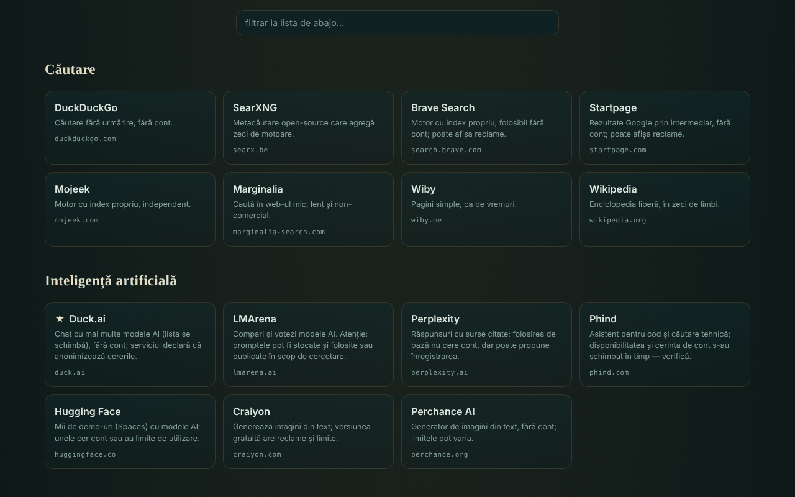

# OAZĂ — servicios en línea regalados

[English](README.md) · [Română](README.ro.md) · [Français](README.fr.md) · [Italiano](README.it.md) · **Español** · [Português](README.pt.md) · [Deutsch](README.de.md) · [Magyar](README.hu.md)

**Versión:** 1.2.4 · **Última actualización:** 2026-10-22

Idiomas de la interfaz: **Română, English, Français, Italiano, Español, Português (PT), Deutsch, Magyar**

Catálogo de 340 servicios web gratuitos, en 54 categorías, elegidos porque se pueden usar sin cuenta (en su forma básica), en un único archivo HTML.

**En línea:** https://chiuta.github.io/OAZA/

## Qué es

OAZĂ es una «página de inicio» en el espíritu del movimiento trade-free: una lista de herramientas y servicios externos (búsqueda, IA, mapas, código, lectura, música, ciencia, software libre, recursos rumanos y otros), agrupados por categorías, con una barra de búsqueda que abre el motor de búsqueda elegido. El autor verificó la lista el **16 de junio de 2026**; **puede estar desactualizada** (véase «Límites y advertencias»).

El archivo es un «quine» editable: se puede modificar en la página, y el botón «descargar» genera un archivo nuevo, también autónomo, con tus cambios.

## Funciones

- 340 servicios en 54 categorías; fichas con una descripción breve, dominio y etiquetas (`TROM`, `local`, `instabil`, `temp`, ★ recomendado); algunas categorías tienen una nota de precaución.
- Filtrado instantáneo de la lista (sin distinguir signos diacríticos: «cautare» encuentra «Căutare»), con un mensaje cuando no hay resultados; la tecla `/` lleva el cursor al campo de filtro.
- Tema claro automático (`prefers-color-scheme: light`) y estilo de impresión (fichas en 3 columnas, con la dirección completa; barras y botones ocultos).
- Barra de búsqueda con 7 motores (DuckDuckGo, SearXNG, Brave, Startpage, Mojeek, Marginalia, Wikipedia); la búsqueda se abre en una pestaña nueva.
- Modo de edición: añades, modificas, mueves o borras servicios; añades, renombras o borras categorías; editas el título y el subtítulo; ves y editas los datos JSON en bruto; importas/exportas JSON; restableces la lista predeterminada.
- Compartir mediante un enlace con fragmento `#d=` (tu lista se codifica en la dirección); al abrirlo aparece una advertencia de que la lista no es la del autor, y las direcciones se depuran (solo `http`/`https`).
- «Descargar este archivo» y «fuente (quine)»: el archivo se reconstruye solo, incluidos tus cambios.
- Advertencia al abandonar la página si tienes cambios sin guardar.
- Script de verificación periódica de los servicios: `tools/verifica-servicii.mjs` (se ejecuta en local; en el teléfono, en Termux: `curl -sL https://raw.githubusercontent.com/chiuta/OAZA/main/tools/verifica-termux.sh | bash`; véase `servicii-de-verificat.md`).

## Manual de uso

1. Abre la página y recorre las categorías, o escribe en el campo «filtrar la lista» para acotar las fichas.
2. Para una búsqueda en la web, elige el motor a la izquierda de la barra, escribe el término y pulsa «buscar» o Intro; el motor elegido se abre en una pestaña nueva.
3. Haz clic en una ficha para abrir el servicio en una pestaña nueva. Lee antes la descripción y la nota de la categoría (anuncios, límites, licencias).
4. Para personalizar tu lista pulsa «✎ editar esta página»; luego usa los botones de las fichas y la barra superior.
5. Para conservar los cambios pulsa «↧ descargar este archivo» y guarda el archivo; para enviarlos a otra persona pulsa «⇗ enlace» (las listas muy grandes producen enlaces muy largos).
6. «↺ restablecer» vuelve a la lista predeterminada; «volver al catálogo original» (en la advertencia de arriba) elimina una lista cargada desde un enlace.

## Privacidad y red

- Almacenamiento local: no usa `localStorage`, `sessionStorage`, IndexedDB ni cookies; los cambios solo existen en la página abierta hasta que los descargues.
- Red: la página no carga scripts, fuentes, imágenes ni otros recursos externos. La única llamada de red de la página es una solicitud a su propio archivo (mismo origen), hecha al cargar solo cuando la página se sirve por `http(s)`, para el indicador «quine verificado» de la insignia de la cabecera; tiene un tiempo de espera de 6 segundos. Una `Content-Security-Policy` en la página restringe las conexiones al mismo origen.
- Hosts externos: los de los 340 servicios listados (318 dominios distintos) y los de los 7 motores de búsqueda. Se contactan **solo cuando haces clic** en una ficha o en «buscar»; la página no envía referrer (`no-referrer`). El término buscado llega al motor elegido, y lo que hagas en los servicios listados lo regulan ellos, no OAZĂ.
- Permisos del navegador: no solicita ningún permiso (ubicación, cámara, micrófono).
- La afirmación «sin telemetría» se refiere al archivo OAZĂ, no a los servicios externos.

## Límites y advertencias

- **Servicios de terceros.** Los servicios listados no pertenecen al autor y no tienen relación con él (salvo los etiquetados TROM). Figurar en la lista no es una recomendación. Pueden exigir cuenta, mostrar anuncios, añadir planes de pago, cambiar las condiciones o desaparecer en cualquier momento.
- **Afirmaciones no verificadas automáticamente.** Etiquetas como «sin cuenta», «gratuito», «open-source», «sin seguimiento» reproducen el conocimiento del autor o las declaraciones de los servicios, en la fecha de verificación (16 de junio de 2026); no son garantías. `servicii-de-verificat.md` contiene la lista de servicios que deben reverificarse manualmente y un procedimiento periódico.
- **Privacidad.** No envíes datos sensibles a servicios públicos (transferencia de archivos, notas, llamadas, escaneo). Los frontends a través de Farside redirigen a instancias públicas de terceros y con frecuencia no están disponibles.
- **Derechos de autor.** El estatus de «dominio público» difiere de un país a otro; las licencias de imágenes, música y fuentes difieren de un servicio a otro. Comprueba la licencia antes de reutilizar.
- **Salud y seguridad.** Los recursos médicos son información general y no sustituyen una consulta médica; en una emergencia llama al 112. Los mapas meteorológicos/marinos no son la única fuente para la navegación o la seguridad.
- **Listas compartidas.** Un enlace `#d=` puede mostrar una lista hecha por otra persona; las direcciones se filtran a `http`/`https`, pero comprueba el destino antes de abrir un servicio desconocido.

## Ejecución local / sin conexión

Descarga `index.html` y ábrelo en un navegador. El catálogo, el filtrado y la edición funcionan sin Internet; los servicios listados y los motores de búsqueda necesitan conexión. El indicador «quine verificado» aparece solo cuando el archivo se sirve por `http(s)`.

## Licencia

MIT — véase el archivo LICENSE.

## Autor

Alexio — Alexandru-Ionuț Chiuță, contacto: alexio@trom.tf

## Resumen

OAZĂ es un catálogo rumano en un solo archivo de 340 servicios web gratuitos en 54 categorías, elegidos porque su uso básico no necesita cuenta, más una barra de búsqueda que abre el motor elegido. Es editable y autorreproducible («quine»): la descarga produce un archivo autónomo nuevo con tus cambios. La página en sí no tiene telemetría, no usa almacenamiento del navegador y no carga recursos externos; los sitios externos solo se contactan cuando haces clic. Las descripciones de los servicios de terceros fueron verificadas por el autor el 16 de junio de 2026 y pueden estar desactualizadas; véanse `servicii-de-verificat.md` y `tools/verifica-servicii.mjs`.

## Historial / Changelog

- 1.2.4 — 2026-10-22: fff-kit 1.1.2: PBKDF2 con 600.000 iteraciones, protección anti-clickjacking
- 1.2.3 — 2026-10-22: Las 13 llamadas nativas alert()/confirm()/prompt() (borrar, renombrar y añadir categoría, restablecer, copiar enlace, importación no válida) se sustituyen por diálogos y avisos integrados (ya traducidos); texto ≥ 12 px en móvil; zona del pie más grande.

- 1.1.0 — 2026-10-14: Copia de seguridad y etiquetado de datos (fff-kit).

- 1.0.0 — 2026-10-12: la versión y la fecha de la última actualización se muestran en la aplicación
- **11 de octubre de 2026** (ronda 7) — CSP con `script-src` por hash SHA-256, sin `'unsafe-inline'`. Se rompió el círculo «el hash del script está en el propio script»: la cáscara codificada del quine contiene un marcador en lugar del meta CSP, y `buildSource` lo completa en tiempo de ejecución con el meta de la página abierta (así el hash está solo en el archivo del disco, no en `Q`). Verificado: el archivo abierto es idéntico byte a byte a `SELF_SOURCE`, y un archivo generado tras una modificación (segunda generación) se carga sin infracciones de CSP y es a su vez un quine fiel; axe 0 infracciones a 1280×800 y 360×740. Si editas el script a mano, recalcula el hash en el meta CSP.
- **11 de octubre de 2026** — reparado el quine: la cáscara codificada en la página no incluía el punto de referencia `main`, así que «descargar» y «fuente» producían un archivo distinto del abierto; ahora el archivo descargado es idéntico byte a byte al abierto (verificado). Añadidos el tema claro, el estilo de impresión y el atajo `/`. Nota: una política CSP por hash de script no es posible, porque el script contiene su propia fuente codificada (autorreferencia); permanece `'unsafe-inline'`.
- **11 de octubre de 2026** — el contenido de la página (búsqueda, notas, filtro, categorías) está encuadrado en un único punto de referencia `main`, de modo que axe-core da 0 infracciones a 1280×800 y 360×740; verificado que el filtro y «fuente (quine)» funcionan sin errores de JS.
- La lista de 340 servicios **no se reverificó** en esta ronda: las afirmaciones «sin cuenta / gratuito / sin seguimiento» pertenecen al autor y a la fecha que muestra la página («verificado por el autor · 16 de junio de 2026 · puede estar desactualizado»), que no cambió; la reverificación se hace en local con `tools/verifica-servicii.mjs` (véase `servicii-de-verificat.md`). La aplicación no tiene número de versión.

### 1.2.2 — 2026-10-22
- Los nombres de unas 15 entradas rumanas del catálogo (Mapas TROM, Wikcionario, Portal de los tribunales, etc.) están traducidos a todos los idiomas.

