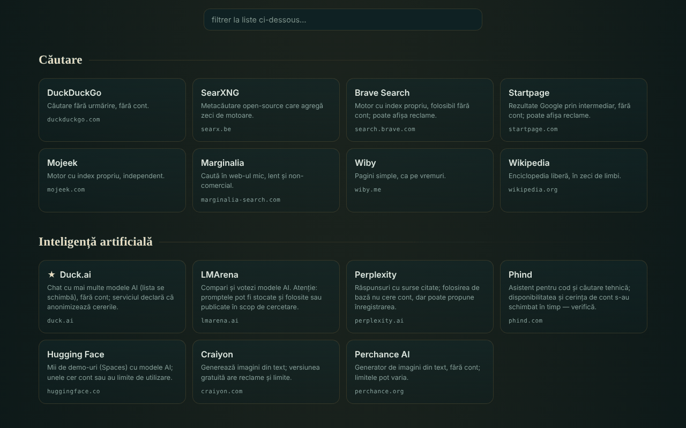

# OAZĂ — services en ligne offerts

[English](README.md) · [Română](README.ro.md) · **Français** · [Italiano](README.it.md) · [Español](README.es.md) · [Português](README.pt.md) · [Deutsch](README.de.md) · [Magyar](README.hu.md)

**Version :** 1.2.1 · **Dernière mise à jour :** 2026-10-19

Langues de l'interface : **Română, English, Français, Italiano, Español, Português (PT), Deutsch, Magyar**

Catalogue de 340 services web gratuits, répartis en 54 catégories, choisis parce qu'ils peuvent être utilisés sans compte (dans leur forme de base), dans un seul fichier HTML.

**En ligne :** https://chiuta.github.io/OAZA/

## Ce que c'est

OAZĂ est une « page de démarrage » dans l'esprit du mouvement trade-free : une liste d'outils et de services externes (recherche, IA, cartes, code, lecture, musique, science, logiciel libre, ressources roumaines, etc.), regroupés par catégories, avec une barre de recherche qui ouvre le moteur de recherche choisi. L'auteur a vérifié la liste le **16 juin 2026** ; elle **peut être dépassée** (voir « Limites et avertissements »).

Le fichier est un « quine » modifiable : on peut le modifier dans la page, et le bouton « télécharger » génère un nouveau fichier, lui aussi autonome, avec vos modifications.

## Fonctions

- 340 services en 54 catégories ; cartes avec une courte description, le domaine et des étiquettes (`TROM`, `local`, `instabil`, `temp`, ★ recommandé) ; certaines catégories comportent une note de prudence.
- Filtrage instantané de la liste (sans tenir compte des diacritiques : « cautare » trouve « Căutare »), avec un message lorsqu'il n'y a aucun résultat ; la touche `/` place le curseur dans le champ de filtrage.
- Thème clair automatique (`prefers-color-scheme: light`) et style d'impression (cartes sur 3 colonnes, avec l'adresse complète ; barres et boutons masqués).
- Barre de recherche avec 7 moteurs (DuckDuckGo, SearXNG, Brave, Startpage, Mojeek, Marginalia, Wikipédia) ; la recherche s'ouvre dans un nouvel onglet.
- Mode édition : vous ajoutez, modifiez, déplacez ou supprimez des services ; ajoutez, renommez ou supprimez des catégories ; modifiez le titre et le sous-titre ; voyez et modifiez les données JSON brutes ; importez/exportez du JSON ; réinitialisez la liste par défaut.
- Partage par lien avec un fragment `#d=` (votre liste est codée dans l'adresse) ; à l'ouverture, un avertissement indique que la liste n'est pas celle de l'auteur, et les adresses sont nettoyées (seulement `http`/`https`).
- « Télécharger ce fichier » et « source (quine) » : le fichier se reconstruit lui-même, y compris vos modifications.
- Avertissement à la fermeture de la page si vous avez des modifications non enregistrées.
- Script de vérification périodique des services : `tools/verifica-servicii.mjs` (à exécuter en local ; sur téléphone, dans Termux : `curl -sL https://raw.githubusercontent.com/chiuta/OAZA/main/tools/verifica-termux.sh | bash` ; voir `servicii-de-verificat.md`).

## Mode d'emploi

1. Ouvrez la page et parcourez les catégories, ou saisissez dans le champ « filtrer la liste » pour restreindre les cartes.
2. Pour une recherche sur le web, choisissez le moteur à gauche de la barre, saisissez le terme et appuyez sur « rechercher » ou Entrée ; le moteur choisi s'ouvre dans un nouvel onglet.
3. Cliquez sur une carte pour ouvrir le service dans un nouvel onglet. Lisez d'abord la description et la note de la catégorie (publicités, limites, licences).
4. Pour personnaliser votre liste, appuyez sur « ✎ modifier cette page » ; utilisez ensuite les boutons des cartes et la barre supérieure.
5. Pour conserver vos modifications, appuyez sur « ↧ télécharger ce fichier » et enregistrez le fichier ; pour les envoyer à quelqu'un d'autre, appuyez sur « ⇗ lien » (les listes très grandes produisent des liens très longs).
6. « ↺ réinitialiser » revient à la liste par défaut ; « revenir au catalogue d'origine » (dans l'avertissement du haut) supprime une liste chargée depuis un lien.

## Confidentialité et réseau

- Stockage local : n'utilise ni `localStorage`, ni `sessionStorage`, ni IndexedDB, ni cookies ; les modifications n'existent que dans la page ouverte jusqu'à ce que vous les téléchargiez.
- Réseau : la page ne charge ni scripts, ni polices, ni images, ni autres ressources externes. Le seul appel réseau de la page est une requête vers son propre fichier (même origine), effectuée au chargement uniquement lorsque la page est servie via `http(s)`, pour l'indicateur « quine vérifié » du badge de l'en-tête ; elle a un délai d'expiration de 6 secondes. Une `Content-Security-Policy` dans la page restreint les connexions à la même origine.
- Hôtes externes : ceux des 340 services listés (318 domaines distincts) et des 7 moteurs de recherche. Ils ne sont contactés **que lorsque vous cliquez** sur une carte ou sur « rechercher » ; la page n'envoie pas de référent (`no-referrer`). Le terme recherché parvient au moteur choisi, et ce que vous faites sur les services listés est régi par eux, non par OAZĂ.
- Autorisations du navigateur : elle ne demande aucune autorisation (localisation, caméra, microphone).
- L'affirmation « sans télémétrie » concerne le fichier OAZĂ, non les services externes.

## Limites et avertissements

- **Services tiers.** Les services listés n'appartiennent pas à l'auteur et n'ont aucun lien avec lui (sauf ceux étiquetés TROM). Leur présence n'est pas une recommandation. Ils peuvent exiger un compte, afficher des publicités, ajouter des offres payantes, changer leurs conditions ou disparaître à tout moment.
- **Affirmations non vérifiées automatiquement.** Des étiquettes comme « sans compte », « gratuit », « open-source », « sans pistage » reproduisent les connaissances de l'auteur ou les déclarations des services, à la date de vérification (16 juin 2026) ; ce ne sont pas des garanties. `servicii-de-verificat.md` contient la liste des services à revérifier manuellement et une procédure périodique.
- **Confidentialité.** N'envoyez pas de données sensibles à des services publics (transfert de fichiers, notes, appels, numérisation). Les frontaux via Farside redirigent vers des instances publiques de tiers et sont souvent indisponibles.
- **Droits d'auteur.** Le statut de « domaine public » varie d'un pays à l'autre ; les licences des images, de la musique et des polices varient d'un service à l'autre. Vérifiez la licence avant toute réutilisation.
- **Santé et sécurité.** Les ressources médicales sont des informations générales et ne remplacent pas une consultation médicale ; en cas d'urgence, appelez le 112. Les cartes météo/marines ne sont pas la seule source pour la navigation ou la sécurité.
- **Listes partagées.** Un lien `#d=` peut afficher une liste faite par quelqu'un d'autre ; les adresses sont filtrées sur `http`/`https`, mais vérifiez la destination avant d'ouvrir un service inconnu.

## Exécution locale / hors ligne

Téléchargez `index.html` et ouvrez-le dans un navigateur. Le catalogue, le filtrage et l'édition fonctionnent sans Internet ; les services listés et les moteurs de recherche nécessitent une connexion. L'indicateur « quine vérifié » n'apparaît que lorsque le fichier est servi via `http(s)`.

## Licence

MIT — voir le fichier LICENSE.

## Auteur

Alexio — Alexandru-Ionuț Chiuță, contact : alexio@trom.tf

## Résumé
OAZĂ est un catalogue roumain en un seul fichier de 340 services web gratuits répartis en 54 catégories, choisis parce que leur usage de base ne demande aucun compte, avec une barre de recherche qui ouvre le moteur choisi. Il est modifiable et auto-reproducteur (« quine ») : le téléchargement produit un nouveau fichier autonome avec vos modifications. La page elle-même n'a aucune télémétrie, n'utilise aucun stockage du navigateur et ne charge aucune ressource externe ; les sites externes ne sont contactés que lorsque vous cliquez. Les descriptions des services tiers ont été vérifiées par l'auteur le 16 juin 2026 et peuvent être dépassées ; voir `servicii-de-verificat.md` et `tools/verifica-servicii.mjs`.

## Historique / Changelog

- 1.1.0 — 2026-10-14 : Sauvegarde et étiquetage des données (fff-kit).

- 1.0.0 — 2026-10-12 : la version et la date de la dernière mise à jour sont affichées dans l'application
- **11 octobre 2026** (tour 7) — CSP avec `script-src` par hachage SHA-256, sans `'unsafe-inline'`. Le cercle « le hachage du script est dans le script lui-même » a été rompu : la coque codée du quine contient un marqueur à la place de la balise meta CSP, et `buildSource` la complète à l'exécution avec la balise meta de la page ouverte (le hachage ne se trouve donc que dans le fichier sur disque, pas dans `Q`). Vérifié : le fichier ouvert est identique octet pour octet à `SELF_SOURCE`, et un fichier généré après une modification (deuxième génération) se charge sans violation de CSP et est à son tour un quine fidèle ; axe 0 violation à 1280×800 et 360×740. Si vous modifiez le script à la main, recalculez le hachage dans la balise meta CSP.
- **11 octobre 2026** — quine réparé : la coque codée dans la page n'incluait pas le repère `main`, si bien que « télécharger » et « source » produisaient un fichier différent de celui ouvert ; désormais le fichier téléchargé est identique octet pour octet à celui ouvert (vérifié). Ajout du thème clair, du style d'impression et du raccourci `/`. Remarque : une politique CSP par hachage de script n'est pas possible, car le script contient sa propre source codée (auto-référence) ; `'unsafe-inline'` demeure.
- **11 octobre 2026** — le contenu de la page (recherche, notes, filtre, catégories) est encadré dans un seul repère `main`, si bien qu'axe-core donne 0 violation à 1280×800 et 360×740 ; vérifié que le filtre et « source (quine) » fonctionnent sans erreur JS.
- La liste de 340 services **n'a pas été revérifiée** lors de ce tour : les affirmations « sans compte / gratuit / sans pistage » appartiennent à l'auteur et à la date affichée dans la page (« vérifié par l'auteur · 16 juin 2026 · peut être dépassé »), qui est restée inchangée ; la revérification se fait en local avec `tools/verifica-servicii.mjs` (voir `servicii-de-verificat.md`). L'application n'a pas de numéro de version.
