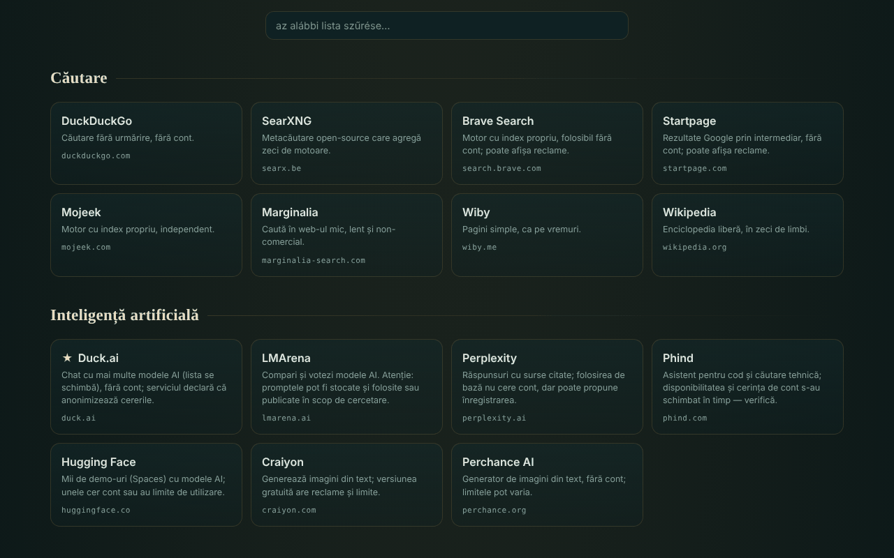

# OAZĂ — ajándékozott online szolgáltatások

[English](README.md) · [Română](README.ro.md) · [Français](README.fr.md) · [Italiano](README.it.md) · [Español](README.es.md) · [Português](README.pt.md) · [Deutsch](README.de.md) · **Magyar**

**Verzió:** 2.0.0 · **Utolsó frissítés:** 2026-10-26

A felület nyelvei: **Română, English, Français, Italiano, Español, Português (PT), Deutsch, Magyar**

340 ingyenes webszolgáltatás katalógusa 54 kategóriában, azért kiválasztva, mert fiók nélkül (alapformájukban) használhatók, egyetlen HTML-fájlban.

**Élő:** https://chiuta.github.io/OAZA/

## Mi ez

Az OAZĂ egy „kezdőoldal” a trade-free mozgalom szellemében: külső eszközök és szolgáltatások listája (keresés, MI, térképek, kód, olvasás, zene, tudomány, szabad szoftver, román nyelvű források és mások), kategóriákba rendezve, egy keresősávval, amely a kiválasztott keresőmotort nyitja meg. A szerző a listát **2026. június 16-án** ellenőrizte; **elavult lehet** (lásd a „Korlátok és figyelmeztetések” részt).

A fájl egy szerkeszthető „quine”: módosítható magában az oldalban, és a „letöltés” gomb új, szintén önálló fájlt hoz létre a módosításaiddal.

## Funkciók

- 340 szolgáltatás 54 kategóriában; kártyák rövid leírással, doménnel és címkékkel (`TROM`, `local`, `instabil`, `temp`, ★ ajánlott); egyes kategóriákhoz óvatosságra intő megjegyzés tartozik.
- A lista azonnali szűrése (ékezetek nélkül: a „cautare” megtalálja a „Căutare” szót), üzenettel, ha nincs találat; a `/` billentyű a kurzort a szűrőmezőbe teszi.
- Automatikus világos téma (`prefers-color-scheme: light`) és nyomtatási stílus (kártyák 3 oszlopban, teljes címmel; a sávok és gombok elrejtve).
- Kereséssáv 7 motorral (DuckDuckGo, SearXNG, Brave, Startpage, Mojeek, Marginalia, Wikipedia); a keresés új lapon nyílik meg.
- Szerkesztő mód: szolgáltatásokat adsz hozzá, módosítasz, mozgatsz vagy törölsz; kategóriákat adsz hozzá, nevezel át vagy törölsz; szerkeszted a címet és az alcímet; látod és szerkeszted a nyers JSON-adatokat; JSON-t importálsz/exportálsz; visszaállítod az alapértelmezett listát.
- Megosztás `#d=` töredékes hivatkozással (a listád a címbe van kódolva); megnyitáskor figyelmeztetés jelenik meg, hogy a lista nem a szerzőé, és a címek megtisztításra kerülnek (csak `http`/`https`).
- „A fájl letöltése” és „forrás (quine)”: a fájl önmagát építi újra, a módosításaiddal együtt.
- Figyelmeztetés az oldal elhagyásakor, ha mentetlen módosításaid vannak.
- Szkript a szolgáltatások időszakos ellenőrzésére: `tools/verifica-servicii.mjs` (helyben futtatandó; telefonon, Termuxban: `curl -sL https://raw.githubusercontent.com/chiuta/OAZA/main/tools/verifica-termux.sh | bash`; lásd `servicii-de-verificat.md`).

## Használati útmutató

1. Nyisd meg az oldalt, és böngészd a kategóriákat, vagy írj a „lista szűrése” mezőbe a kártyák szűkítéséhez.
2. Webes kereséshez válaszd ki a motort a sáv bal oldalán, írd be a kifejezést, és nyomd meg a „keresés” gombot vagy az Entert; a kiválasztott motor új lapon nyílik meg.
3. Kattints egy kártyára, hogy a szolgáltatás új lapon megnyíljon. Előtte olvasd el a leírást és a kategória megjegyzését (hirdetések, korlátok, licencek).
4. A lista testreszabásához nyomd meg a „✎ az oldal szerkesztése” gombot; utána használd a kártyákon lévő gombokat és a felső sávot.
5. A módosítások megőrzéséhez nyomd meg a „↧ a fájl letöltése” gombot, és mentsd el a fájlt; hogy másnak elküldd, nyomd meg a „⇗ hivatkozás” gombot (a nagyon nagy listák nagyon hosszú hivatkozást adnak).
6. A „↺ visszaállítás” visszatér az alapértelmezett listához; az „vissza az eredeti katalógushoz” (a felső figyelmeztetésben) eltávolítja a hivatkozásból betöltött listát.

## Adatvédelem és hálózat

- Helyi tárhely: nem használ `localStorage`-t, `sessionStorage`-t, IndexedDB-t vagy sütiket; a módosítások csak a megnyitott oldalban léteznek, amíg le nem töltöd őket.
- Hálózat: az oldal nem tölt be szkripteket, betűtípusokat, képeket vagy más külső erőforrásokat. Az oldal egyetlen hálózati hívása egy kérés a saját fájljához (azonos origin), betöltéskor, csak akkor, ha az oldalt `http(s)`-en keresztül szolgálják ki, a fejlécben lévő jelvény „quine ellenőrizve” jelzéséhez; időtúllépése 6 másodperc. Az oldalban lévő `Content-Security-Policy` az azonos originre korlátozza a kapcsolatokat.
- Külső gazdagépek: a 340 felsorolt szolgáltatásé (318 különböző domén) és a 7 keresőmotoré. **Csak akkor** veszi fel velük a kapcsolatot, **ha** egy kártyára vagy a „keresés” gombra **kattintasz**; az oldal nem küld referert (`no-referrer`). A keresett kifejezés a kiválasztott motorhoz jut el, és azt, hogy mit csinálsz a felsorolt szolgáltatásokon, azok szabályozzák, nem az OAZĂ.
- Böngészőengedélyek: nem kér semmilyen engedélyt (helyadat, kamera, mikrofon).
- A „telemetria nélkül” állítás az OAZĂ fájlra vonatkozik, nem a külső szolgáltatásokra.

## Korlátok és figyelmeztetések

- **Harmadik felek szolgáltatásai.** A felsorolt szolgáltatások nem a szerzőé, és nincs közük hozzá (kivéve a TROM-mal címkézetteket). A felsorolás nem ajánlás. Kérhetnek fiókot, megjeleníthetnek hirdetéseket, fizetős csomagokat adhatnak hozzá, módosíthatják a feltételeiket, vagy bármikor megszűnhetnek.
- **Automatikusan nem ellenőrzött állítások.** Az olyan címkék, mint a „fiók nélkül”, „ingyenes”, „nyílt forráskódú”, „követés nélkül”, a szerző tudását vagy a szolgáltatások nyilatkozatait tükrözik az ellenőrzés napján (2026. június 16.); nem garanciák. A `servicii-de-verificat.md` tartalmazza a kézzel újraellenőrzendő szolgáltatások listáját és egy időszakos eljárást.
- **Adatvédelem.** Ne küldj érzékeny adatokat nyilvános szolgáltatásoknak (fájlátvitel, jegyzetek, hívások, szkennelés). A Farside-on keresztüli felületek harmadik felek nyilvános példányaira irányítanak át, és gyakran nem érhetők el.
- **Szerzői jog.** A „közkincs” státusz országonként eltér; a képek, zenék és betűtípusok licencei szolgáltatásonként eltérnek. Újrafelhasználás előtt ellenőrizd a licencet.
- **Egészség és biztonság.** Az orvosi források általános tájékoztatást nyújtanak, és nem helyettesítik az orvosi konzultációt; vészhelyzetben hívd a 112-t. Az időjárási/tengeri térképek nem az egyetlen források a navigációhoz vagy a biztonsághoz.
- **Megosztott listák.** Egy `#d=` hivatkozás valaki más által készített listát jeleníthet meg; a címek `http`/`https` szerint szűrtek, de ellenőrizd a célt, mielőtt ismeretlen szolgáltatást nyitsz meg.

## Helyi / offline futtatás

Töltsd le az `index.html` fájlt, és nyisd meg böngészőben. A katalógus, a szűrés és a szerkesztés internet nélkül működik; a felsorolt szolgáltatásokhoz és a keresőmotorokhoz kapcsolat kell. A „quine ellenőrizve” jelzés csak akkor jelenik meg, ha a fájlt `http(s)`-en keresztül szolgálják ki.

## Licenc

MIT — lásd a LICENSE fájlt.

## Szerző

Alexio — Alexandru-Ionuț Chiuță, kapcsolat: alexio@trom.tf

## Összefoglaló
Az OAZĂ egyetlen fájlba zárt, román nyelvű katalógus 340 ingyenes webszolgáltatásról 54 kategóriában, azért kiválasztva, mert alapvető használatukhoz nem kell fiók, kiegészítve egy keresősávval, amely a kiválasztott motort nyitja meg. Szerkeszthető és önreprodukáló („quine”): a letöltés új, önálló fájlt hoz létre a módosításaiddal. Maga az oldal nem használ telemetriát és böngészőtárolót, és nem tölt be külső erőforrásokat; a külső oldalakkal csak kattintásra veszi fel a kapcsolatot. A harmadik felek szolgáltatásainak leírásait a szerző 2026. június 16-án ellenőrizte, és elavultak lehetnek; lásd a `servicii-de-verificat.md` és a `tools/verifica-servicii.mjs` fájlt.

## Előzmények / Changelog

### 1.2.6 — 2026-10-22

fff-kit 1.1.4: érintési célok és minimális szövegméret.

- 1.2.5 — 2026-10-22: Offline: valódi service worker, webes manifest és ikonok (telepíthető, offline is újraindul); az átláthatósági leíró mostantól deklarálja a service workert.
- 1.2.4 — 2026-10-22: fff-kit 1.1.2: PBKDF2 600 000 iterációval, clickjacking elleni védelem
- 1.2.3 — 2026-10-22: Mind a 13 natív alert()/confirm()/prompt() hívás (törlés, kategória átnevezése és hozzáadása, visszaállítás, hivatkozás másolása, érvénytelen import) oldalon belüli párbeszédpanelre és értesítésre cserélve (már lefordítva); legalább 12 px szöveg mobilon; nagyobb lábléc-célpont.

- 1.1.0 — 2026-10-14: Biztonsági mentés és adatcímkézés (fff-kit).

- 1.0.0 — 2026-10-12: a verzió és az utolsó frissítés dátuma megjelenik az alkalmazásban
- **2026. október 11.** (7. kör) — CSP `script-src` SHA-256 hash alapján, `'unsafe-inline'` nélkül. Megszakadt a „a szkript hash-e a saját szkriptjében van” kör: a quine-ba kódolt héj a CSP meta helyén egy jelölőt tartalmaz, a `buildSource` pedig futásidőben a megnyitott oldal metájával tölti ki (tehát a hash csak a lemezen lévő fájlban van, a `Q`-ban nem). Ellenőrizve: a megnyitott fájl bájtra azonos a `SELF_SOURCE`-szal, és egy módosítás után generált fájl (második generáció) CSP-sértések nélkül betöltődik, és maga is hű quine; axe 0 hiba 1280×800 és 360×740 méretnél. Ha kézzel szerkeszted a szkriptet, számold újra a hash-t a CSP metában.
- **2026. október 11.** — a quine javítva: az oldalba kódolt héj nem tartalmazta a `main` tájékozódási pontot, ezért a „letöltés” és a „forrás” a megnyitottól eltérő fájlt állított elő; most a letöltött fájl bájtra azonos a megnyitottal (ellenőrizve). Hozzáadva a világos téma, a nyomtatási stílus és a `/` billentyűparancs. Megjegyzés: a szkript-hash alapú CSP-szabályzat nem lehetséges, mert a szkript tartalmazza a saját kódolt forrását (önhivatkozás); a `'unsafe-inline'` marad.
- **2026. október 11.** — az oldal tartalma (keresés, megjegyzések, szűrő, kategóriák) egyetlen `main` tájékozódási pontba van foglalva, így az axe-core 0 hibát ad 1280×800 és 360×740 méretnél; ellenőrizve, hogy a szűrő és a „forrás (quine)” JS-hibák nélkül működik.
- A 340 szolgáltatás listáját ebben a körben **nem ellenőrizték újra**: a „fiók nélkül / ingyenes / követés nélkül” állítások a szerzőé és az oldalon megjelenített dátumé („a szerző ellenőrizte · 2026. június 16. · elavult lehet”), amely változatlan maradt; az újraellenőrzés helyben történik a `tools/verifica-servicii.mjs` szkripttel (lásd `servicii-de-verificat.md`). Az alkalmazásnak nincs verziószáma.

### 1.2.2 — 2026-10-22
- A katalógus kb. 15 román nyelvű bejegyzésének neve (TROM Térképek, Wikiszótár, Bírósági portál stb.) minden nyelven le van fordítva.

