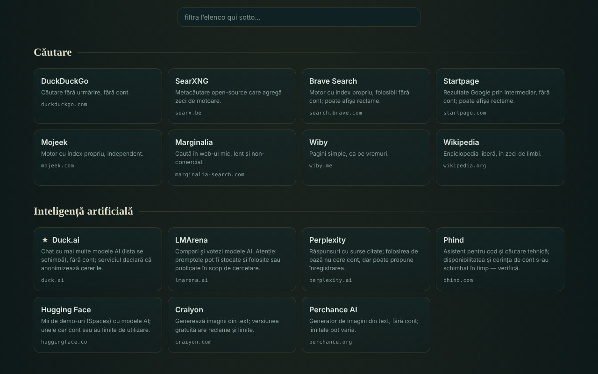

# OAZĂ — servizi online donati

[English](README.md) · [Română](README.ro.md) · [Français](README.fr.md) · **Italiano** · [Español](README.es.md) · [Português](README.pt.md) · [Deutsch](README.de.md) · [Magyar](README.hu.md)

**Versione:** 1.2.0 · **Ultimo aggiornamento:** 2026-10-19

Lingue dell'interfaccia: **Română, English, Français, Italiano, Español, Português (PT), Deutsch, Magyar**

Catalogo di 340 servizi web gratuiti, in 54 categorie, scelti perché si possono usare senza account (nella loro forma di base), in un unico file HTML.

**Online:** https://chiuta.github.io/OAZA/

## Che cos'è

OAZĂ è una «startpage» nello spirito del movimento trade-free: un elenco di strumenti e servizi esterni (ricerca, IA, mappe, codice, lettura, musica, scienza, software libero, risorse rumene e altro), raggruppati per categorie, con una barra di ricerca che apre il motore di ricerca scelto. L'autore ha verificato l'elenco il **16 giugno 2026**; esso **può essere superato** (vedi «Limiti e avvertenze»).

Il file è un «quine» modificabile: si può modificare nella pagina, e il pulsante «scarica» genera un nuovo file, anch'esso autonomo, con le tue modifiche.

## Funzioni

- 340 servizi in 54 categorie; schede con una breve descrizione, dominio ed etichette (`TROM`, `local`, `instabil`, `temp`, ★ consigliato); alcune categorie hanno una nota di cautela.
- Filtraggio istantaneo dell'elenco (senza segni diacritici: «cautare» trova «Căutare»), con un messaggio quando non ci sono risultati; il tasto `/` sposta il cursore nel campo di filtro.
- Tema chiaro automatico (`prefers-color-scheme: light`) e stile di stampa (schede su 3 colonne, con l'indirizzo completo; barre e pulsanti nascosti).
- Barra di ricerca con 7 motori (DuckDuckGo, SearXNG, Brave, Startpage, Mojeek, Marginalia, Wikipedia); la ricerca si apre in una nuova scheda.
- Modalità di modifica: aggiungi, modifichi, sposti o elimini servizi; aggiungi, rinomini o elimini categorie; modifichi il titolo e il sottotitolo; vedi e modifichi i dati JSON grezzi; importi/esporti JSON; ripristini l'elenco predefinito.
- Condivisione tramite link con frammento `#d=` (il tuo elenco è codificato nell'indirizzo); all'apertura compare un avviso che l'elenco non è quello dell'autore, e gli indirizzi vengono ripuliti (solo `http`/`https`).
- «Scarica questo file» e «sorgente (quine)»: il file si ricostruisce da solo, incluse le tue modifiche.
- Avviso all'uscita dalla pagina se ci sono modifiche non salvate.
- Script di verifica periodica dei servizi: `tools/verifica-servicii.mjs` (da eseguire in locale; su telefono, in Termux: `curl -sL https://raw.githubusercontent.com/chiuta/OAZA/main/tools/verifica-termux.sh | bash`; vedi `servicii-de-verificat.md`).

## Guida all'uso

1. Apri la pagina e sfoglia le categorie, oppure scrivi nel campo «filtra l'elenco» per restringere le schede.
2. Per una ricerca sul web, scegli il motore a sinistra della barra, scrivi il termine e premi «cerca» o Invio; il motore scelto si apre in una nuova scheda.
3. Fai clic su una scheda per aprire il servizio in una nuova scheda. Leggi prima la descrizione e la nota della categoria (pubblicità, limiti, licenze).
4. Per personalizzare il tuo elenco premi «✎ modifica questa pagina»; poi usa i pulsanti sulle schede e la barra in alto.
5. Per conservare le modifiche premi «↧ scarica questo file» e salva il file; per inviarle a qualcun altro premi «⇗ link» (gli elenchi molto grandi producono link molto lunghi).
6. «↺ ripristina» torna all'elenco predefinito; «torna al catalogo originale» (dall'avviso in alto) rimuove un elenco caricato da un link.

## Privacy e rete

- Archiviazione locale: non usa `localStorage`, `sessionStorage`, IndexedDB né cookie; le modifiche esistono solo nella pagina aperta finché non le scarichi.
- Rete: la pagina non carica script, font, immagini o altre risorse esterne. L'unica chiamata di rete della pagina è una richiesta al proprio file (stessa origine), effettuata al caricamento solo quando la pagina è servita tramite `http(s)`, per l'indicatore «quine verificato» del badge nell'intestazione; ha un timeout di 6 secondi. Una `Content-Security-Policy` nella pagina limita le connessioni alla stessa origine.
- Host esterni: quelli dei 340 servizi elencati (318 domini distinti) e dei 7 motori di ricerca. Vengono contattati **solo quando fai clic** su una scheda o su «cerca»; la pagina non invia il referrer (`no-referrer`). Il termine cercato arriva al motore scelto, e ciò che fai sui servizi elencati è regolato da loro, non da OAZĂ.
- Permessi del browser: non richiede alcun permesso (posizione, fotocamera, microfono).
- L'affermazione «senza telemetria» si riferisce al file OAZĂ, non ai servizi esterni.

## Limiti e avvertenze

- **Servizi di terzi.** I servizi elencati non appartengono all'autore e non hanno legami con lui (tranne quelli etichettati TROM). L'inserimento non è una raccomandazione. Possono richiedere un account, mostrare pubblicità, aggiungere piani a pagamento, cambiare le condizioni o scomparire in qualsiasi momento.
- **Affermazioni non verificate automaticamente.** Etichette come «senza account», «gratuito», «open-source», «senza tracciamento» riproducono le conoscenze dell'autore o le dichiarazioni dei servizi, alla data di verifica (16 giugno 2026); non sono garanzie. `servicii-de-verificat.md` contiene l'elenco dei servizi da riverificare manualmente e una procedura periodica.
- **Privacy.** Non inviare dati sensibili a servizi pubblici (trasferimento di file, note, chiamate, scansione). I frontend tramite Farside reindirizzano a istanze pubbliche di terzi e sono spesso non disponibili.
- **Diritto d'autore.** Lo stato di «pubblico dominio» varia da un paese all'altro; le licenze di immagini, musica e font variano da servizio a servizio. Verifica la licenza prima di riutilizzare.
- **Salute e sicurezza.** Le risorse mediche sono informazioni generali e non sostituiscono una visita medica; in caso di emergenza chiama il 112. Le mappe meteo/marine non sono l'unica fonte per la navigazione o la sicurezza.
- **Elenchi condivisi.** Un link `#d=` può mostrare un elenco creato da qualcun altro; gli indirizzi sono filtrati su `http`/`https`, ma verifica la destinazione prima di aprire un servizio sconosciuto.

## Esecuzione locale / offline

Scarica `index.html` e aprilo in un browser. Il catalogo, il filtraggio e la modifica funzionano senza Internet; i servizi elencati e i motori di ricerca richiedono una connessione. L'indicatore «quine verificato» compare solo quando il file è servito tramite `http(s)`.

## Licenza

MIT — vedi il file LICENSE.

## Autore

Alexio — Alexandru-Ionuț Chiuță, contatto: alexio@trom.tf

## Riepilogo
OAZĂ è un catalogo rumeno in un unico file di 340 servizi web gratuiti in 54 categorie, scelti perché il loro uso di base non richiede un account, con una barra di ricerca che apre il motore scelto. È modificabile e autoriproducente («quine»): il download produce un nuovo file autonomo con le tue modifiche. La pagina stessa non ha telemetria, non usa l'archiviazione del browser e non carica risorse esterne; i siti esterni vengono contattati solo quando fai clic. Le descrizioni dei servizi di terzi sono state verificate dall'autore il 16 giugno 2026 e possono essere superate; vedi `servicii-de-verificat.md` e `tools/verifica-servicii.mjs`.

## Cronologia / Changelog

- 1.1.0 — 2026-10-14: Copia di riserva ed etichettatura dei dati (fff-kit).

- 1.0.0 — 2026-10-12: la versione e la data dell'ultimo aggiornamento sono mostrate nell'app
- **11 ottobre 2026** (turno 7) — CSP con `script-src` tramite hash SHA-256, senza `'unsafe-inline'`. Il circolo «l'hash dello script è nello script stesso» è stato spezzato: il guscio codificato nel quine contiene un segnaposto al posto del meta CSP, e `buildSource` lo completa a runtime con il meta della pagina aperta (quindi l'hash sta solo nel file su disco, non in `Q`). Verificato: il file aperto è identico byte per byte a `SELF_SOURCE`, e un file generato dopo una modifica (seconda generazione) si carica senza violazioni CSP ed è a sua volta un quine fedele; axe 0 violazioni a 1280×800 e 360×740. Se modifichi lo script a mano, ricalcola l'hash nel meta CSP.
- **11 ottobre 2026** — riparato il quine: il guscio codificato nella pagina non includeva il riferimento `main`, quindi «scarica» e «sorgente» producevano un file diverso da quello aperto; ora il file scaricato è identico byte per byte a quello aperto (verificato). Aggiunti il tema chiaro, lo stile di stampa e la scorciatoia `/`. Nota: una politica CSP basata sull'hash dello script non è possibile, perché lo script contiene la propria sorgente codificata (autoriferimento); resta `'unsafe-inline'`.
- **11 ottobre 2026** — il contenuto della pagina (ricerca, note, filtro, categorie) è racchiuso in un unico riferimento `main`, quindi axe-core dà 0 violazioni a 1280×800 e 360×740; verificato che il filtro e «sorgente (quine)» funzionano senza errori JS.
- L'elenco di 340 servizi **non è stato riverificato** in questo turno: le affermazioni «senza account / gratuito / senza tracciamento» appartengono all'autore e alla data mostrata nella pagina («verificato dall'autore · 16 giugno 2026 · può essere superato»), rimasta invariata; la riverifica si fa in locale con `tools/verifica-servicii.mjs` (vedi `servicii-de-verificat.md`). L'app non ha un numero di versione.
