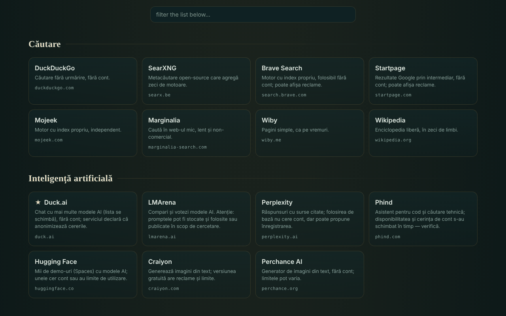

# OAZĂ — gifted online services

**English** · [Română](README.ro.md) · [Français](README.fr.md) · [Italiano](README.it.md) · [Español](README.es.md) · [Português](README.pt.md) · [Deutsch](README.de.md) · [Magyar](README.hu.md)

**Version:** 2.0.0 · **Last updated:** 2026-10-26

Interface languages: **Română, English, Français, Italiano, Español, Português (PT), Deutsch, Magyar**

A catalogue of 340 free web services in 54 categories, chosen because they can be used without an account (in their basic form), in a single HTML file.

**Live:** https://chiuta.github.io/OAZA/

## What it is

OAZĂ is a "startpage" in the spirit of the trade-free movement: a list of external tools and services (search, AI, maps, code, reading, music, science, free software, Romanian resources and others), grouped by category, with a search bar that opens the search engine of your choice. The author checked the list on **16 June 2026**; it **may be out of date** (see "Limits and warnings").

The file is an editable "quine": it can be modified in the page, and the "download" button generates a new file, also self-contained, with your changes.

## Features

- **Focus (2.0)**: the "🌿 focus" button opens a short, fully offline flow: guided breathing (in/hold/out with an animated circle that respects `prefers-reduced-motion`), pauses with a message and **ambient sound generated in the browser** (rain, brown noise, waves; WebAudio, no audio files). 3 ready-made programs, **custom programs** (reorderable breathing/pause steps; max 60 min) and a **local journal** (duration, mood 1–5, note; stored on the device only, clearable in one click). Not a medical tool.
- 340 services in 54 categories; cards with a short description, domain and tags (`TROM`, `local`, `instabil`, `temp`, ★ recommended); some categories have a cautionary note.
- Instant filtering of the list (diacritic-insensitive: "cautare" finds "Căutare"), with a message when there are no results; the `/` key moves the cursor to the filter field.
- Automatic light theme (`prefers-color-scheme: light`) and print style (cards in 3 columns, with the full address; bars and buttons hidden).
- Search bar with 7 engines (DuckDuckGo, SearXNG, Brave, Startpage, Mojeek, Marginalia, Wikipedia); the search opens in a new tab.
- Edit mode: you add, modify, move or delete services; add, rename or delete categories; edit the title and subtitle; see and edit the raw JSON data; import/export JSON; reset to the default list.
- Sharing through a link with a `#d=` fragment (your list is encoded in the address); on opening, a warning appears that the list is not the author's, and the addresses are sanitised (only `http`/`https`).
- "Download this file" and "source (quine)": the file rebuilds itself, including your changes.
- Warning when leaving the page if you have unsaved changes.
- A script for periodically verifying the services: `tools/verifica-servicii.mjs` (run locally; on a phone, in Termux: `curl -sL https://raw.githubusercontent.com/chiuta/OAZA/main/tools/verifica-termux.sh | bash`; see `servicii-de-verificat.md`).

## User guide

1. Open the page and browse the categories or type in the "filter the list" field to narrow down the cards.
2. For a web search, choose the engine on the left of the bar, type the term and press "search" or Enter; the chosen engine opens in a new tab.
3. Click a card to open the service in a new tab. Read the description and the category note first (ads, limits, licences).
4. To customise your list, press "✎ edit this page"; then use the buttons on the cards and the top bar.
5. To keep your changes, press "↧ download this file" and save the file; to send them to someone else, press "⇗ link" (very large lists produce very long links).
6. "↺ reset" goes back to the default list; "return to the original catalogue" (from the warning at the top) removes a list loaded from a link.

## Privacy and network

- Local storage: it uses no `localStorage`, `sessionStorage`, IndexedDB or cookies; changes exist only in the open page until you download them.
- Network: the page loads no scripts, fonts, images or other external resources. The page's only network call is a request to its own file (same origin), made on load only when the page is served over `http(s)`, for the "quine verified" indicator on the header badge; it has a 6-second timeout. A `Content-Security-Policy` in the page restricts connections to the same origin.
- External hosts: those of the 340 listed services (318 distinct domains) and of the 7 search engines. They are contacted **only when you click** a card or "search"; the page sends no referrer (`no-referrer`). The search term reaches the chosen engine, and what you do on the listed services is governed by them, not by OAZĂ.
- Browser permissions: it requests no permission (location, camera, microphone).
- The claim "no telemetry" refers to the OAZĂ file, not to the external services.

## Limits and warnings

- **Third-party services.** The listed services do not belong to the author and have no connection with him (except those labelled TROM). Listing is not a recommendation. They may require an account, display ads, add paid plans, change their terms or disappear at any time.
- **Claims not verified automatically.** Labels such as "no account", "free", "open-source", "no tracking" reproduce the author's knowledge or the services' own statements, as of the verification date (16 June 2026); they are not guarantees. `servicii-de-verificat.md` contains the list of services that must be re-checked manually and a periodic procedure.
- **Privacy.** Do not send sensitive data to public services (file transfer, notes, calls, scanning). Front-ends through Farside redirect to public instances run by third parties and are often unavailable.
- **Copyright.** "Public domain" status differs from one country to another; the licences of images, music and fonts differ from service to service. Check the licence before reuse.
- **Health and safety.** Medical resources are general information and do not replace a medical consultation; in an emergency call 112. Weather/marine maps are not the only source for navigation or safety.
- **Shared lists.** A `#d=` link may display a list made by someone else; the addresses are filtered to `http`/`https`, but check the destination before opening an unknown service.

## Running locally / offline

Download `index.html` and open it in a browser. The catalogue, filtering and editing work without internet; the listed services and the search engines need a connection. The "quine verified" indicator appears only when the file is served over `http(s)`.

## License

MIT — see the LICENSE file.

## Author

Alexio — Alexandru-Ionuț Chiuță, contact: alexio@trom.tf

## English summary

OAZĂ is a single-file Romanian-language catalog of 340 free web services in 54 categories, chosen because their basic use needs no account, plus a search bar that opens your chosen engine. It is editable and self-reproducing ("quine"): download produces a new standalone file with your changes. The page itself has no telemetry, no browser storage and loads no external resources; external sites are contacted only when you click. Descriptions of third-party services were checked by the author on 16 June 2026 and may be out of date; see `servicii-de-verificat.md` and `tools/verifica-servicii.mjs`.

## History / Changelog

### 1.2.6 — 2026-10-22

fff-kit 1.1.4: touch targets and minimum text size.

- 1.2.5 — 2026-10-22: Offline: real service worker, web manifest and icons (installable, restarts offline); the transparency descriptor now declares the service worker.
- 1.2.4 — 2026-10-22: fff-kit 1.1.2: PBKDF2 600,000 iterations, anti-clickjacking protection
- 1.2.3 — 2026-10-22: All 13 native alert()/confirm()/prompt() calls (delete, rename and add category, reset, link copy fallback, invalid import) are replaced by in-page dialogs and notices (already translated); text ≥ 12 px on mobile; larger footer target.

- 1.1.0 — 2026-10-14: Backup and data labelling (fff-kit).

- 1.0.0 — 2026-10-12: the version and the date of the last update are shown in the app
- **11 October 2026** (round 7) — CSP with `script-src` by SHA-256 hash, without `'unsafe-inline'`. The circle "the script's hash is in the script itself" was broken: the shell encoded in the quine contains a marker in place of the CSP meta, and `buildSource` fills it in at run time with the meta of the open page (so the hash lives only in the file on disk, not in `Q`). Verified: the open file is byte-for-byte identical to `SELF_SOURCE`, and a file generated after a modification (second generation) loads without CSP violations and is in turn a faithful quine; axe 0 violations at 1280×800 and 360×740. If you edit the script manually, recalculate the hash in the CSP meta.
- **11 October 2026** — fixed the quine: the shell encoded in the page did not include the `main` landmark, so "download" and "source" produced a file different from the open one; now the downloaded file is byte-for-byte identical to the open one (verified). Added the light theme, the print style and the `/` shortcut. Note: a script-hash CSP policy is not possible, because the script contains its own encoded source (self-reference); `'unsafe-inline'` remains.
- **11 October 2026** — the page content (search, notes, filter, categories) is wrapped in a single `main` landmark, so axe-core gives 0 violations at 1280×800 and 360×740; verified that the filter and "source (quine)" work without JS errors.
- The list of 340 services was **not re-verified** in this round: the claims "no account / free / no tracking" belong to the author and to the date shown in the page ("verified by the author · 16 June 2026 · may be out of date"), which stayed unchanged; re-verification is done locally with `tools/verifica-servicii.mjs` (see `servicii-de-verificat.md`). The app has no version number.

### 1.2.2 — 2026-10-22
- Names of about 15 Romanian-language catalog entries (TROM Maps, Wiktionary, Courts portal and others) are now translated in all languages.

