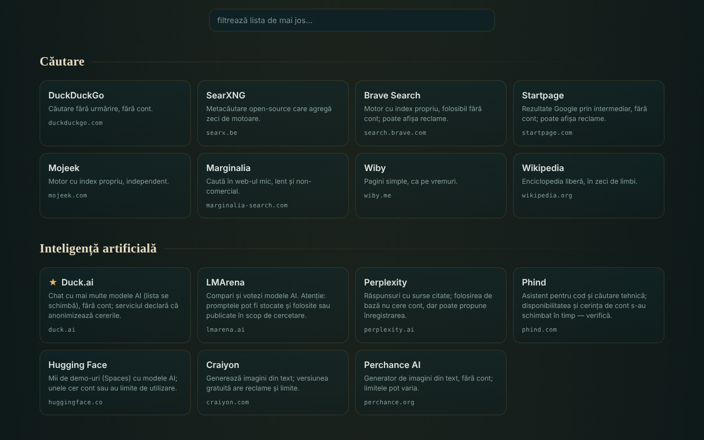

# OAZĂ — servicii online dăruite

Catalog de 340 de servicii web gratuite, în 54 de categorii, alese pentru că pot fi folosite fără cont (în forma lor de bază), într-un singur fișier HTML.

**Live:** https://chiuta.github.io/OAZA/

## Ce este

OAZĂ este un „startpage” în spiritul mișcării trade-free: o listă de unelte și servicii externe (căutare, AI, hărți, cod, lectură, muzică, știință, software liber, resurse românești ș.a.), grupate pe categorii, cu o bară de căutare care deschide motorul de căutare ales. Autorul a verificat lista la **16 iunie 2026**; ea **poate fi depășită** (vezi „Limite și avertismente”).

Fișierul este un „quine” editabil: se poate modifica în pagină, iar butonul „descarcă” generează un fișier nou, tot autonom, cu modificările tale.

## Funcții

- 340 de servicii în 54 de categorii; carduri cu descriere scurtă, domeniu și etichete (`TROM`, `local`, `instabil`, `temp`, ★ recomandat); unele categorii au o notă de prudență.
- Filtrare instantanee a listei (fără diacritice: „cautare” găsește „Căutare”), cu mesaj când nu există rezultate.
- Bară de căutare cu 7 motoare (DuckDuckGo, SearXNG, Brave, Startpage, Mojeek, Marginalia, Wikipedia); căutarea se deschide într-o filă nouă.
- Mod de editare: adaugi, modifici, muți sau ștergi servicii; adaugi, redenumești sau ștergi categorii; editezi titlul și sub-titlul; vezi și editezi datele brute JSON; importi/exporți JSON; resetezi la lista implicită.
- Partajare prin link cu fragment `#d=` (lista ta e codată în adresă); la deschidere apare un avertisment că lista nu este cea a autorului, iar adresele sunt curățate (doar `http`/`https`).
- „Descarcă acest fișier” și „sursă (quine)”: fișierul se reconstruiește singur, inclusiv modificările tale.
- Avertisment la părăsirea paginii dacă ai modificări nesalvate.
- Script de verificare periodică a serviciilor: `tools/verifica-servicii.mjs` (se rulează local; vezi `servicii-de-verificat.md`).

## Manual de utilizare

1. Deschide pagina și răsfoiește categoriile sau scrie în câmpul „filtrează lista” pentru a restrânge cardurile.
2. Pentru o căutare pe web alege motorul din stânga barei, scrie termenul și apasă „caută” sau Enter; se deschide motorul ales într-o filă nouă.
3. Apasă un card pentru a deschide serviciul într-o filă nouă. Citește descrierea și nota categoriei înainte (reclame, limite, licențe).
4. Pentru a-ți personaliza lista apasă „✎ editează această pagină”; apoi folosește butoanele de pe carduri și bara de sus.
5. Pentru a păstra modificările apasă „↧ descarcă acest fișier” și salvează fișierul; pentru a le trimite altcuiva apasă „⇗ link” (listele foarte mari produc linkuri foarte lungi).
6. „↺ resetează” revine la lista implicită; „revino la catalogul original” (din avertismentul de sus) elimină o listă încărcată dintr-un link.

## Confidențialitate și rețea

- Stocare locală: nu folosește `localStorage`, `sessionStorage`, IndexedDB sau cookie-uri; modificările există doar în pagina deschisă până le descarci.
- Rețea: pagina nu încarcă scripturi, fonturi, imagini sau alte resurse externe. Singurul apel de rețea al paginii este o cerere către propriul fișier (aceeași origine), făcută la încărcare numai când pagina e servită prin `http(s)`, pentru indicatorul „quine verificat” de la insigna din antet; are timeout de 6 secunde. Un `Content-Security-Policy` din pagină restrânge conexiunile la aceeași origine.
- Gazde externe: ale celor 340 de servicii listate (318 domenii distincte) și ale celor 7 motoare de căutare. Se contactează **doar când apeși** un card sau „caută”; pagina nu trimite referrer (`no-referrer`). Termenul căutat ajunge la motorul ales, iar ce faci pe serviciile listate este reglementat de ele, nu de OAZĂ.
- Permisiuni ale browserului: nu cere nicio permisiune (locație, cameră, microfon).
- Afirmația „fără telemetrie” se referă la fișierul OAZĂ, nu la serviciile externe.

## Limite și avertismente

- **Servicii terțe.** Serviciile listate nu aparțin autorului și nu au legătură cu el (cu excepția celor etichetate TROM). Listarea nu este o recomandare. Ele pot cere cont, afișa reclame, adăuga planuri plătite, schimba condițiile sau dispărea oricând.
- **Afirmații neverificate automat.** Etichete precum „fără cont”, „gratuit”, „open-source”, „fără urmărire” reproduc cunoștințele autorului sau declarațiile serviciilor, la data verificării (16 iunie 2026); nu sunt garanții. `servicii-de-verificat.md` conține lista serviciilor care trebuie reverificate manual și o procedură periodică.
- **Confidențialitate.** Nu trimite date sensibile unor servicii publice (transfer de fișiere, notițe, apeluri, scanare). Frontend-urile prin Farside redirecționează către instanțe publice ale unor terți și sunt adesea indisponibile.
- **Drepturi de autor.** Statutul de „domeniu public” diferă de la o țară la alta; licențele imaginilor, muzicii și fonturilor diferă de la serviciu la serviciu. Verifică licența înainte de reutilizare.
- **Sănătate și siguranță.** Resursele medicale sunt informații generale, nu înlocuiesc consultul medical; în urgență sunați la 112. Hărțile meteo/marine nu sunt singura sursă pentru navigație sau siguranță.
- **Liste partajate.** Un link `#d=` poate afișa o listă făcută de altcineva; adresele sunt filtrate la `http`/`https`, dar verifică destinația înainte să deschizi un serviciu necunoscut.

## Rulare locală / offline

Descarcă `index.html` și deschide-l în browser. Catalogul, filtrarea și editarea funcționează fără internet; serviciile listate și motoarele de căutare au nevoie de conexiune. Indicatorul „quine verificat” apare doar când fișierul e servit prin `http(s)`.

## Licență

Licența nu este încă declarată.

## Autor

Alexio — Alexandru-Ionuț Chiuță, contact: alexio@trom.tf

## English summary

OAZĂ is a single-file Romanian-language catalog of 340 free web services in 54 categories, chosen because their basic use needs no account, plus a search bar that opens your chosen engine. It is editable and self-reproducing ("quine"): download produces a new standalone file with your changes. The page itself has no telemetry, no browser storage and loads no external resources; external sites are contacted only when you click. Descriptions of third-party services were checked by the author on 16 June 2026 and may be out of date; see `servicii-de-verificat.md` and `tools/verifica-servicii.mjs`.
