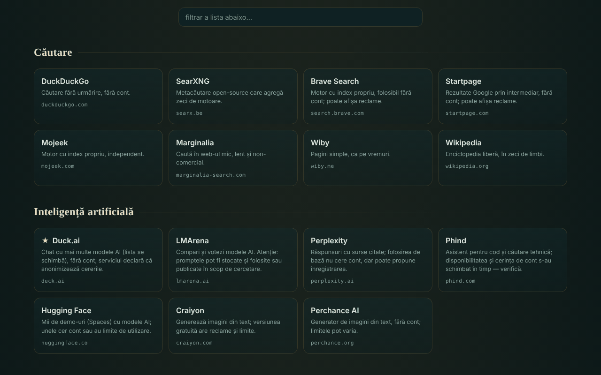

# OAZĂ — serviços online oferecidos

[English](README.md) · [Română](README.ro.md) · [Français](README.fr.md) · [Italiano](README.it.md) · [Español](README.es.md) · **Português** · [Deutsch](README.de.md) · [Magyar](README.hu.md)

**Versão:** 1.2.7 · **Última atualização:** 2026-10-23

Idiomas da interface: **Română, English, Français, Italiano, Español, Português (PT), Deutsch, Magyar**

Catálogo de 340 serviços web gratuitos, em 54 categorias, escolhidos porque podem ser usados sem conta (na sua forma básica), num único ficheiro HTML.

**Online:** https://chiuta.github.io/OAZA/

## O que é

A OAZĂ é uma «página inicial» no espírito do movimento trade-free: uma lista de ferramentas e serviços externos (pesquisa, IA, mapas, código, leitura, música, ciência, software livre, recursos romenos e outros), agrupados por categorias, com uma barra de pesquisa que abre o motor de pesquisa escolhido. O autor verificou a lista a **16 de junho de 2026**; ela **pode estar desatualizada** (ver «Limites e avisos»).

O ficheiro é um «quine» editável: pode ser modificado na página, e o botão «transferir» gera um novo ficheiro, também autónomo, com as suas alterações.

## Funcionalidades

- 340 serviços em 54 categorias; cartões com uma descrição curta, domínio e etiquetas (`TROM`, `local`, `instabil`, `temp`, ★ recomendado); algumas categorias têm uma nota de prudência.
- Filtragem instantânea da lista (sem distinguir sinais diacríticos: «cautare» encontra «Căutare»), com uma mensagem quando não há resultados; a tecla `/` leva o cursor ao campo de filtro.
- Tema claro automático (`prefers-color-scheme: light`) e estilo de impressão (cartões em 3 colunas, com o endereço completo; barras e botões ocultos).
- Barra de pesquisa com 7 motores (DuckDuckGo, SearXNG, Brave, Startpage, Mojeek, Marginalia, Wikipédia); a pesquisa abre-se num novo separador.
- Modo de edição: adiciona, modifica, move ou elimina serviços; adiciona, renomeia ou elimina categorias; edita o título e o subtítulo; vê e edita os dados JSON em bruto; importa/exporta JSON; repõe a lista predefinida.
- Partilha através de uma ligação com fragmento `#d=` (a sua lista fica codificada no endereço); ao abrir, aparece um aviso de que a lista não é a do autor, e os endereços são depurados (apenas `http`/`https`).
- «Transferir este ficheiro» e «fonte (quine)»: o ficheiro reconstrói-se sozinho, incluindo as suas alterações.
- Aviso ao sair da página se tiver alterações por guardar.
- Script de verificação periódica dos serviços: `tools/verifica-servicii.mjs` (executa-se localmente; no telemóvel, no Termux: `curl -sL https://raw.githubusercontent.com/chiuta/OAZA/main/tools/verifica-termux.sh | bash`; ver `servicii-de-verificat.md`).

## Manual de utilização

1. Abra a página e percorra as categorias, ou escreva no campo «filtrar a lista» para restringir os cartões.
2. Para uma pesquisa na web, escolha o motor à esquerda da barra, escreva o termo e prima «pesquisar» ou Enter; o motor escolhido abre-se num novo separador.
3. Clique num cartão para abrir o serviço num novo separador. Leia antes a descrição e a nota da categoria (anúncios, limites, licenças).
4. Para personalizar a sua lista, prima «✎ editar esta página»; depois use os botões dos cartões e a barra superior.
5. Para guardar as alterações, prima «↧ transferir este ficheiro» e guarde o ficheiro; para as enviar a outra pessoa, prima «⇗ ligação» (listas muito grandes produzem ligações muito longas).
6. «↺ repor» volta à lista predefinida; «voltar ao catálogo original» (no aviso do topo) remove uma lista carregada a partir de uma ligação.

## Privacidade e rede

- Armazenamento local: não usa `localStorage`, `sessionStorage`, IndexedDB nem cookies; as alterações existem apenas na página aberta até as transferir.
- Rede: a página não carrega scripts, tipos de letra, imagens nem outros recursos externos. A única chamada de rede da página é um pedido ao seu próprio ficheiro (mesma origem), feito ao carregar apenas quando a página é servida por `http(s)`, para o indicador «quine verificado» do emblema do cabeçalho; tem um tempo limite de 6 segundos. Uma `Content-Security-Policy` na página restringe as ligações à mesma origem.
- Anfitriões externos: os dos 340 serviços listados (318 domínios distintos) e os dos 7 motores de pesquisa. São contactados **apenas quando clica** num cartão ou em «pesquisar»; a página não envia referrer (`no-referrer`). O termo pesquisado chega ao motor escolhido, e o que fizer nos serviços listados é regulado por eles, não pela OAZĂ.
- Permissões do navegador: não solicita nenhuma permissão (localização, câmara, microfone).
- A afirmação «sem telemetria» refere-se ao ficheiro OAZĂ, não aos serviços externos.

## Limites e avisos

- **Serviços de terceiros.** Os serviços listados não pertencem ao autor e não têm ligação a ele (exceto os etiquetados TROM). A listagem não é uma recomendação. Podem exigir conta, apresentar anúncios, acrescentar planos pagos, alterar as condições ou desaparecer a qualquer momento.
- **Afirmações não verificadas automaticamente.** Etiquetas como «sem conta», «gratuito», «open-source», «sem rastreamento» reproduzem o conhecimento do autor ou as declarações dos serviços, na data de verificação (16 de junho de 2026); não são garantias. `servicii-de-verificat.md` contém a lista dos serviços que devem ser reverificados manualmente e um procedimento periódico.
- **Privacidade.** Não envie dados sensíveis a serviços públicos (transferência de ficheiros, notas, chamadas, digitalização). Os frontends através do Farside redirecionam para instâncias públicas de terceiros e estão frequentemente indisponíveis.
- **Direitos de autor.** O estatuto de «domínio público» difere de país para país; as licenças de imagens, música e tipos de letra diferem de serviço para serviço. Verifique a licença antes de reutilizar.
- **Saúde e segurança.** Os recursos médicos são informação geral e não substituem uma consulta médica; em caso de emergência, ligue 112. Os mapas meteorológicos/marítimos não são a única fonte para navegação ou segurança.
- **Listas partilhadas.** Uma ligação `#d=` pode mostrar uma lista feita por outra pessoa; os endereços são filtrados para `http`/`https`, mas verifique o destino antes de abrir um serviço desconhecido.

## Execução local / offline

Transfira `index.html` e abra-o num navegador. O catálogo, a filtragem e a edição funcionam sem Internet; os serviços listados e os motores de pesquisa precisam de ligação. O indicador «quine verificado» só aparece quando o ficheiro é servido por `http(s)`.

## Licença

MIT — veja o ficheiro LICENSE.

## Autor

Alexio — Alexandru-Ionuț Chiuță, contacto: alexio@trom.tf

## Resumo
A OAZĂ é um catálogo romeno num único ficheiro de 340 serviços web gratuitos em 54 categorias, escolhidos porque a sua utilização básica não precisa de conta, com uma barra de pesquisa que abre o motor escolhido. É editável e autorreprodutível («quine»): a transferência produz um novo ficheiro autónomo com as suas alterações. A própria página não tem telemetria, não usa armazenamento do navegador e não carrega recursos externos; os sítios externos só são contactados quando clica. As descrições dos serviços de terceiros foram verificadas pelo autor a 16 de junho de 2026 e podem estar desatualizadas; ver `servicii-de-verificat.md` e `tools/verifica-servicii.mjs`.

## Histórico / Changelog

### 1.2.6 — 2026-10-22

fff-kit 1.1.4: alvos de toque e tamanho mínimo do texto.

- 1.2.5 — 2026-10-22: Offline: service worker real, manifesto web e ícones (instalável, reinicia offline); o descritor de transparência declara agora o service worker.
- 1.2.4 — 2026-10-22: fff-kit 1.1.2: PBKDF2 com 600.000 iterações, proteção anti-clickjacking
- 1.2.3 — 2026-10-22: As 13 chamadas nativas alert()/confirm()/prompt() (eliminar, renomear e adicionar categoria, repor, copiar ligação, importação inválida) foram substituídas por diálogos e avisos integrados (já traduzidos); texto ≥ 12 px em telemóvel; área do rodapé maior.

- 1.1.0 — 2026-10-14: Cópia de segurança e etiquetagem de dados (fff-kit).

- 1.0.0 — 2026-10-12: a versão e a data da última atualização são apresentadas na aplicação
- **11 de outubro de 2026** (ronda 7) — CSP com `script-src` por hash SHA-256, sem `'unsafe-inline'`. Quebrou-se o círculo «o hash do script está no próprio script»: a casca codificada do quine contém um marcador no lugar do meta CSP, e `buildSource` completa-o em tempo de execução com o meta da página aberta (assim o hash está apenas no ficheiro em disco, não em `Q`). Verificado: o ficheiro aberto é idêntico byte a byte a `SELF_SOURCE`, e um ficheiro gerado após uma modificação (segunda geração) carrega sem violações de CSP e é, por sua vez, um quine fiel; axe 0 violações a 1280×800 e 360×740. Se editar o script manualmente, recalcule o hash no meta CSP.
- **11 de outubro de 2026** — corrigido o quine: a casca codificada na página não incluía o ponto de referência `main`, pelo que «transferir» e «fonte» produziam um ficheiro diferente do aberto; agora o ficheiro transferido é idêntico byte a byte ao aberto (verificado). Adicionados o tema claro, o estilo de impressão e o atalho `/`. Nota: uma política CSP por hash de script não é possível, porque o script contém a sua própria fonte codificada (autorreferência); mantém-se `'unsafe-inline'`.
- **11 de outubro de 2026** — o conteúdo da página (pesquisa, notas, filtro, categorias) está enquadrado num único ponto de referência `main`, pelo que o axe-core dá 0 violações a 1280×800 e 360×740; verificado que o filtro e «fonte (quine)» funcionam sem erros de JS.
- A lista de 340 serviços **não foi reverificada** nesta ronda: as afirmações «sem conta / gratuito / sem rastreamento» pertencem ao autor e à data apresentada na página («verificado pelo autor · 16 de junho de 2026 · pode estar desatualizado»), que ficou inalterada; a reverificação faz-se localmente com `tools/verifica-servicii.mjs` (ver `servicii-de-verificat.md`). A aplicação não tem número de versão.

### 1.2.2 — 2026-10-22
- Os nomes de cerca de 15 entradas romenas do catálogo (Mapas TROM, Wikcionário, Portal dos tribunais, etc.) estão traduzidos em todos os idiomas.

