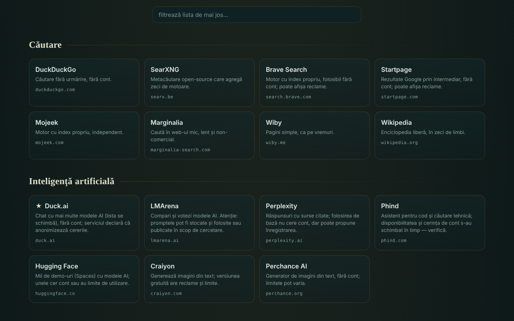

# OAZĂ — servicii online dăruite

[English](README.md) · **Română** · [Français](README.fr.md) · [Italiano](README.it.md) · [Español](README.es.md) · [Português](README.pt.md) · [Deutsch](README.de.md) · [Magyar](README.hu.md)

**Versiune:** 1.2.0 · **Ultima actualizare:** 2026-10-19

Limbile interfeței: **Română, English, Français, Italiano, Español, Português (PT), Deutsch, Magyar**

Catalog de 340 de servicii web gratuite, în 54 de categorii, alese pentru că pot fi folosite fără cont (în forma lor de bază), într-un singur fișier HTML.

**Live:** https://chiuta.github.io/OAZA/

## Ce este

OAZĂ este un „startpage” în spiritul mișcării trade-free: o listă de unelte și servicii externe (căutare, AI, hărți, cod, lectură, muzică, știință, software liber, resurse românești ș.a.), grupate pe categorii, cu o bară de căutare care deschide motorul de căutare ales. Autorul a verificat lista la **16 iunie 2026**; ea **poate fi depășită** (vezi „Limite și avertismente”).

Fișierul este un „quine” editabil: se poate modifica în pagină, iar butonul „descarcă” generează un fișier nou, tot autonom, cu modificările tale.

## Funcții

- 340 de servicii în 54 de categorii; carduri cu descriere scurtă, domeniu și etichete (`TROM`, `local`, `instabil`, `temp`, ★ recomandat); unele categorii au o notă de prudență.
- Filtrare instantanee a listei (fără diacritice: „cautare” găsește „Căutare”), cu mesaj când nu există rezultate; tasta `/` mută cursorul în câmpul de filtrare.
- Temă luminoasă automată (`prefers-color-scheme: light`) și stil de tipărire (carduri pe 3 coloane, cu adresa completă; bare și butoane ascunse).
- Bară de căutare cu 7 motoare (DuckDuckGo, SearXNG, Brave, Startpage, Mojeek, Marginalia, Wikipedia); căutarea se deschide într-o filă nouă.
- Mod de editare: adaugi, modifici, muți sau ștergi servicii; adaugi, redenumești sau ștergi categorii; editezi titlul și sub-titlul; vezi și editezi datele brute JSON; importi/exporți JSON; resetezi la lista implicită.
- Partajare prin link cu fragment `#d=` (lista ta e codată în adresă); la deschidere apare un avertisment că lista nu este cea a autorului, iar adresele sunt curățate (doar `http`/`https`).
- „Descarcă acest fișier” și „sursă (quine)”: fișierul se reconstruiește singur, inclusiv modificările tale.
- Avertisment la părăsirea paginii dacă ai modificări nesalvate.
- Script de verificare periodică a serviciilor: `tools/verifica-servicii.mjs` (se rulează local; pe telefon, în Termux: `curl -sL https://raw.githubusercontent.com/chiuta/OAZA/main/tools/verifica-termux.sh | bash`; vezi `servicii-de-verificat.md`).

## Manual de utilizare

1. Deschide pagina și răsfoiește categoriile sau scrie în câmpul „filtrează lista” pentru a restrânge cardurile.
2. Pentru o căutare pe web alege motorul din stânga barei, scrie termenul și apasă „caută” sau Enter; se deschide motorul ales într-o filă nouă.
3. Apasă un card pentru a deschide serviciul într-o filă nouă. Citește descrierea și nota categoriei înainte (reclame, limite, licențe).
4. Pentru a-ți personaliza lista apasă „✎ editează această pagină”; apoi folosește butoanele de pe carduri și bara de sus.
5. Pentru a păstra modificările apasă „↧ descarcă acest fișier” și salvează fișierul; pentru a le trimite altcuiva apasă „⇗ link” (listele foarte mari produc linkuri foarte lungi).
6. „↺ resetează” revine la lista implicită; „revino la catalogul original” (din avertismentul de sus) elimină o listă încărcată dintr-un link.

## Confidențialitate și rețea

- Stocare locală: nu folosește `localStorage`, `sessionStorage`, IndexedDB sau cookie-uri; modificările există doar în pagina deschisă până le descarci.
- Rețea: pagina nu încarcă scripturi, fonturi, imagini sau alte resurse externe. Singurul apel de rețea al paginii este o cerere către propriul fișier (aceeași origine), făcută la încărcare numai când pagina e servită prin `http(s)`, pentru indicatorul „quine verificat” de la insigna din antet; are timeout de 6 secunde. Un `Content-Security-Policy` din pagină restrânge conexiunile la aceeași origine.
- Gazde externe: ale celor 340 de servicii listate (318 domenii distincte) și ale celor 7 motoare de căutare. Se contactează **doar când apeși** un card sau „caută”; pagina nu trimite referrer (`no-referrer`). Termenul căutat ajunge la motorul ales, iar ce faci pe serviciile listate este reglementat de ele, nu de OAZĂ.
- Permisiuni ale browserului: nu cere nicio permisiune (locație, cameră, microfon).
- Afirmația „fără telemetrie” se referă la fișierul OAZĂ, nu la serviciile externe.

## Limite și avertismente

- **Servicii terțe.** Serviciile listate nu aparțin autorului și nu au legătură cu el (cu excepția celor etichetate TROM). Listarea nu este o recomandare. Ele pot cere cont, afișa reclame, adăuga planuri plătite, schimba condițiile sau dispărea oricând.
- **Afirmații neverificate automat.** Etichete precum „fără cont”, „gratuit”, „open-source”, „fără urmărire” reproduc cunoștințele autorului sau declarațiile serviciilor, la data verificării (16 iunie 2026); nu sunt garanții. `servicii-de-verificat.md` conține lista serviciilor care trebuie reverificate manual și o procedură periodică.
- **Confidențialitate.** Nu trimite date sensibile unor servicii publice (transfer de fișiere, notițe, apeluri, scanare). Frontend-urile prin Farside redirecționează către instanțe publice ale unor terți și sunt adesea indisponibile.
- **Drepturi de autor.** Statutul de „domeniu public” diferă de la o țară la alta; licențele imaginilor, muzicii și fonturilor diferă de la serviciu la serviciu. Verifică licența înainte de reutilizare.
- **Sănătate și siguranță.** Resursele medicale sunt informații generale, nu înlocuiesc consultul medical; în urgență sunați la 112. Hărțile meteo/marine nu sunt singura sursă pentru navigație sau siguranță.
- **Liste partajate.** Un link `#d=` poate afișa o listă făcută de altcineva; adresele sunt filtrate la `http`/`https`, dar verifică destinația înainte să deschizi un serviciu necunoscut.

## Rulare locală / offline

Descarcă `index.html` și deschide-l în browser. Catalogul, filtrarea și editarea funcționează fără internet; serviciile listate și motoarele de căutare au nevoie de conexiune. Indicatorul „quine verificat” apare doar când fișierul e servit prin `http(s)`.

## Licență

MIT — vezi fișierul LICENSE.

## Autor

Alexio — Alexandru-Ionuț Chiuță, contact: alexio@trom.tf

## Rezumat

OAZĂ este un catalog într-un singur fișier, în limba română, cu 340 de servicii web gratuite în 54 de categorii, alese pentru că utilizarea lor de bază nu cere cont, plus o bară de căutare care deschide motorul ales de tine. Este editabil și autoreproductibil („quine”): descărcarea produce un fișier nou, independent, cu modificările tale. Pagina în sine nu are telemetrie, nu folosește stocarea browserului și nu încarcă resurse externe; site-urile externe sunt contactate doar la clic. Descrierile serviciilor terțe au fost verificate de autor la 16 iunie 2026 și pot fi depășite; vezi `servicii-de-verificat.md` și `tools/verifica-servicii.mjs`.

## Istoric / Changelog

- 1.1.0 — 2026-10-14: Copie de rezervă și etichetare date (fff-kit).

- 1.0.0 — 2026-10-12: versiunea și data ultimei actualizări sunt afișate în aplicație
- **11 octombrie 2026** (runda 7) — CSP cu `script-src` pe hash SHA-256, fără `'unsafe-inline'`. Cercul „hash-ul scriptului e în propriul script” a fost rupt: coaja codată din quine conține un marcaj în locul meta-ului CSP, iar `buildSource` îl completează la rulare cu meta-ul paginii deschise (deci hash-ul stă doar în fișierul de pe disc, nu în `Q`). Verificat: fișierul deschis este identic octet cu octet cu `SELF_SOURCE`, iar un fișier generat după o modificare (generația a doua) se încarcă fără încălcări CSP și este la rândul lui un quine fidel; axe 0 violări la 1280×800 și 360×740. Dacă editezi manual scriptul, recalculează hash-ul din meta-ul CSP.
- **11 octombrie 2026** — reparat quine-ul: coaja codată în pagină nu includea reperul `main`, deci „descarcă” și „sursă” produceau un fișier diferit de cel deschis; acum fișierul descărcat este identic octet cu octet cu cel deschis (verificat). Adăugate tema luminoasă, stilul de tipărire și scurtătura `/`. Notă: o politică CSP pe hash de script nu este posibilă, deoarece scriptul conține propria sursă codată (auto-referință); rămâne `'unsafe-inline'`.
- **11 octombrie 2026** — conținutul paginii (căutare, note, filtru, categorii) este încadrat într-un singur reper `main`, deci axe-core dă 0 violări la 1280×800 și 360×740; verificat că filtrul și „sursă (quine)” funcționează fără erori JS.
- Lista de 340 de servicii **nu a fost reverificată** în această rundă: afirmațiile „fără cont / gratuit / fără urmărire” aparțin autorului și datei afișate în pagină („verificat de autor · 16 iunie 2026 · poate fi depășit”), care a rămas neschimbată; reverificarea se face local cu `tools/verifica-servicii.mjs` (vezi `servicii-de-verificat.md`). Aplicația nu are număr de versiune.
